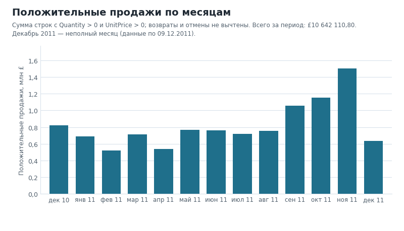
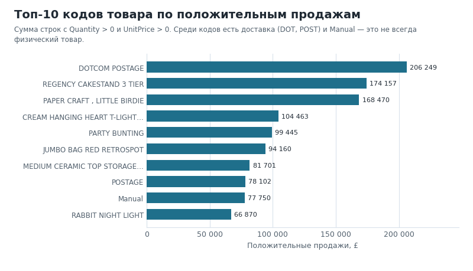
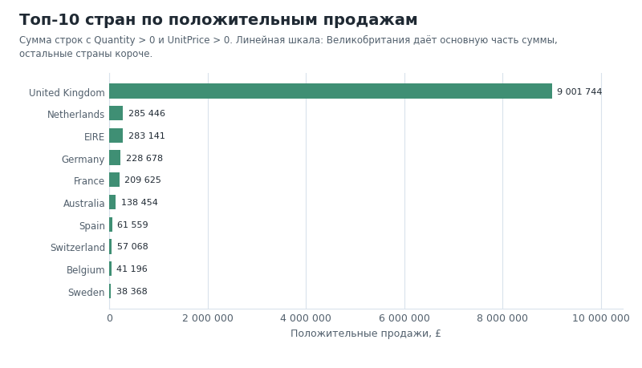

# Анализ продаж интернет-магазина: UCI Online Retail

**Портфолио-проект начинающего аналитика данных.** 541 909 строк транзакций британского интернет-магазина: очистка, метрики в pandas и PostgreSQL и явные ограничения вместо красивых выводов.

**English:** A reproducible exploratory analysis of the UCI Online Retail dataset in Python/pandas and PostgreSQL. Positive sales, returns and cancellations are reported separately, and every published aggregate is re-checked in SQL.

> **Важно:** сумма положительных строк — это стоимость продаж до вычета возвратов и отмен, а не чистая выручка. В наборе нет себестоимости, затрат или подтверждённых сумм возврата денег; прибыль, маржу и скидки этот анализ не рассчитывает.

## Задача и предметная область

Данные одного британского интернет-магазина подарков: счета с 01.12.2010 по 09.12.2011, 541 909 строк и восемь полей — номер счёта, код товара, описание, количество, дата, цена за единицу, клиент, страна.

Задача — пройти путь от «сырых» строк до проверяемых цифр и не выдать при этом лишнего:

- как меняются помесячно сумма положительных строк, число заказов и проданные единицы;
- какие коды товаров и страны дают наибольшую сумму положительных строк;
- как отдельно выглядят возвраты, корректировки и отмены, если их не сворачивать в «чистую выручку»;
- какие пропуски и аномалии ограничивают интерпретацию.

Та же логика реализована дважды — в pandas и в SQL, — а результаты сверяются автоматически.

## Стек

- **Python 3.10+ / pandas** — нормализация, классификация строк, агрегаты, экспорт CSV/JSON; графики — matplotlib.
- **SQL / PostgreSQL 14+** — таблица источника, дедуплицирующее представление, аналитические запросы и инвариантные проверки.
- **unittest и GitHub Actions** — тесты на синтетической выборке и полный прогон на PostgreSQL 16 в CI.

## Ключевые результаты

| Показатель | Значение |
|---|---:|
| Период данных | 01.12.2010 – 09.12.2011 |
| Строк в исходном файле | 541 909 |
| Точных дубликатов удалено | 5 268 |
| Строк после дедупликации | 536 641 |
| Пропусков `CustomerID` в исходнике | 135 080 |
| Положительные продажи (сумма строк) | £10 642 110,80 |
| Заказы с положительной продажей | 19 960 |
| Средний чек (AOV) | £533,17 |
| Проданные единицы | 5 572 420 |
| Клиенты с известным ID | 4 338 |
| Строки отмен | 9 251 / £893 979,73 |
| Отрицательные строки неотменённых счетов | 1 336 |

Числа взяты из [`results/summary.json`](results/summary.json) и [`results/data_quality.json`](results/data_quality.json). «Положительные продажи» — это сумма строк, а не бухгалтерская выручка: отрицательные строки и отмены из неё не вычитаются. 19 960 — это счета, а не клиенты; AOV = £10 642 110,80 ÷ 19 960. 4 338 — только клиенты с известным ID: строки без `CustomerID` входят в сумму, но не в число клиентов. В данных 38 стран и 3 922 кода товара; верхние коды включают доставку и `Manual`, а среди максимальных цен есть `AMAZON FEE` и `Adjust bad debt`, поэтому топ-список — не рейтинг «лучших товаров».

## Графики



*Помесячная сумма положительных строк, млн £; декабрь 2011 — неполный месяц.*



*Топ-10 кодов по сумме положительных строк; доставка (DOT, POST) и Manual входят в список.*



*Топ-10 стран; шкала линейная, поэтому Великобритания визуально доминирует.*

## Как считаются метрики

- **Положительные продажи по строкам:** `SUM(Quantity × UnitPrice)` для строк с `InvoiceNo` без префикса `C`, `Quantity > 0`, `UnitPrice > 0`, заполненными счётом и датой. Это сумма до вычета отрицательных строк и отмен.
- **Заказы и AOV:** `COUNT(DISTINCT InvoiceNo)` среди допустимых положительных строк; средняя сумма заказа — положительные продажи ÷ это число счетов (не клиентов).
- **Проданные единицы:** `SUM(Quantity)` только по допустимым положительным строкам.
- **Возвраты и корректировки:** строки неотменённого счёта с `Quantity < 0`; считаются отдельно независимо от цены. Денежная оценка включает только строки с `UnitPrice > 0` и берётся по модулю — это не подтверждённая сумма возврата денег.
- **Отмены:** счёт, номер которого начинается с `C`. Для денежной оценки берутся строки отмены с отрицательным количеством и положительной ценой, значение — сумма абсолютных величин.
- **Уникальные клиенты:** `COUNT(DISTINCT CustomerID)` среди допустимых положительных строк; строки без ID участвуют в сумме продаж, но не в числе клиентов.

SQL- и Python-реализации используют одинаковые правила. Совпадение проверено на реальном PostgreSQL 18.6: `scripts/verify_sql_parity.py` сравнивает помесячные суммы и топы товаров и стран из `sql/01_analysis.sql` с файлами в `results/` — расхождений нет ([`results/sql_verification.md`](results/sql_verification.md)).

## Как воспроизвести

Нужны Python 3.10+ и PostgreSQL 14+. Команды ниже — для PowerShell из папки проекта; в bash/zsh активация окружения выглядит как `source .venv/bin/activate`.

```powershell
python -m venv .venv
.\.venv\Scripts\Activate.ps1
python -m pip install -r requirements.txt
```

Скачать официальный файл UCI, пересчитать `results/*` и подготовить CSV для PostgreSQL:

```powershell
python scripts/run_analysis.py --download
```

Вместо скачивания можно передать свой файл: `python scripts/run_analysis.py --input "C:\путь\к\Online Retail.xlsx"`. Скрипт создаёт `data/online_retail_for_postgres.csv`; папка `data/` игнорируется Git.

Пересобрать графики из уже посчитанных CSV (исходный датасет не нужен):

```powershell
python scripts/make_readme_charts.py
```

### PostgreSQL

Создайте отдельную базу `ecommerce_retail`, затем из папки проекта выполните:

```powershell
psql -d ecommerce_retail -f sql/00_schema.sql
psql -d ecommerce_retail -c "\copy retail.online_retail_raw(invoice_no, stock_code, description, quantity, invoice_date, unit_price, customer_id, country) FROM 'data/online_retail_for_postgres.csv' WITH (FORMAT csv, HEADER true, NULL '')"
psql -d ecommerce_retail -f sql/01_analysis.sql
psql -d ecommerce_retail -f sql/02_validation.sql
```

Для повторной загрузки сначала очистите таблицу: `TRUNCATE retail.online_retail_raw RESTART IDENTITY;`. Скрипт не создаёт базу и не удаляет таблицы автоматически.

### Тесты и сверка SQL/Python

```powershell
python -m unittest discover -s tests -v
$env:PGCLIENTENCODING = "UTF8"
python scripts/verify_sql_parity.py --dsn "host=127.0.0.1 port=5432 user=postgres dbname=ecommerce_retail"
```

Тесты работают на маленькой искусственной выборке и не требуют датасета. Скрипт сверки сам находит `psql` в `PATH`; если клиент не в `PATH`, можно задать путь переменной `PSQL` — на Windows без настройки он ищет стандартную установку PostgreSQL 18.

Те же шаги выполняет GitHub Actions ([`.github/workflows/ci.yml`](.github/workflows/ci.yml)): job `tests` запускает unittest на Python 3.12, job `postgres` поднимает `postgres:16`, скачивает UCI, загружает CSV, выполняет `01`/`02` и сверяет SQL с Python.

## Ограничения

- **Положительные строки — не чистая выручка.** Возвраты и отмены показаны отдельно и не вычитаются; сумма — это стоимость продаж до вычетов.
- **Нет себестоимости, затрат, скидок и статуса оплаты.** Прибыль, маржу, скидочную политику и юнит-экономику рассчитать нельзя.
- **Один исторический ритейлер, 13 месяцев.** Нельзя переносить выводы на текущий бизнес и нельзя утверждать причинный эффект или «рост благодаря…».
- **Отрицательная строка не доказывает возврат денег.** Отмены и отрицательные строки неотменённых счетов описаны раздельно, их денежная оценка — сумма строк, а не подтверждённый возврат.
- **`CustomerID` отсутствует у части строк** (135 080 в исходнике), поэтому клиентские метрики описывают только атрибутированные записи.
- **Аномалии не отсекаются произвольным порогом.** Максимальная цена — £13 541,33, максимальное количество в строке — 80 995; они остаются в расчёте, а хвост распределения виден в `data_quality.json`.

## Структура проекта

```text
src/analysis.py               очистка, метрики, экспорт results/* и CSV для SQL
scripts/run_analysis.py       команда запуска анализа
scripts/make_readme_charts.py графики для README из results/*.csv
scripts/verify_sql_parity.py  сверка SQL-результатов с Python
sql/00_schema.sql             таблица источника и дедуплицированное представление
sql/01_analysis.sql           качество, метрики, месяцы, товары и страны
sql/02_validation.sql         инвариантные проверки SQL-классификации
tests/test_analysis.py        проверки правил очистки и расчётов
results/                      компактные агрегаты, полученные запуском скрипта
docs/img/                     три PNG-графика для этого README
.github/workflows/ci.yml      тесты и полный прогон на PostgreSQL 16
```

## Лицензия и данные

- **Код** распространяется по лицензии MIT — см. [`LICENSE`](LICENSE).
- **Данные** — [UCI Machine Learning Repository, Online Retail, ID 352](https://archive.ics.uci.edu/dataset/352/online+retail), автор Daqing Chen, DOI [10.24432/C5BW33](https://doi.org/10.24432/C5BW33), лицензия [CC BY 4.0](https://creativecommons.org/licenses/by/4.0/). При распространении результатов нужна атрибуция.
- **Датасет не коммитится:** `data/` в `.gitignore`, скрипт скачивает файл с UCI или принимает локальный. В репозитории лежат только агрегаты в `results/` и графики в `docs/img/`.
